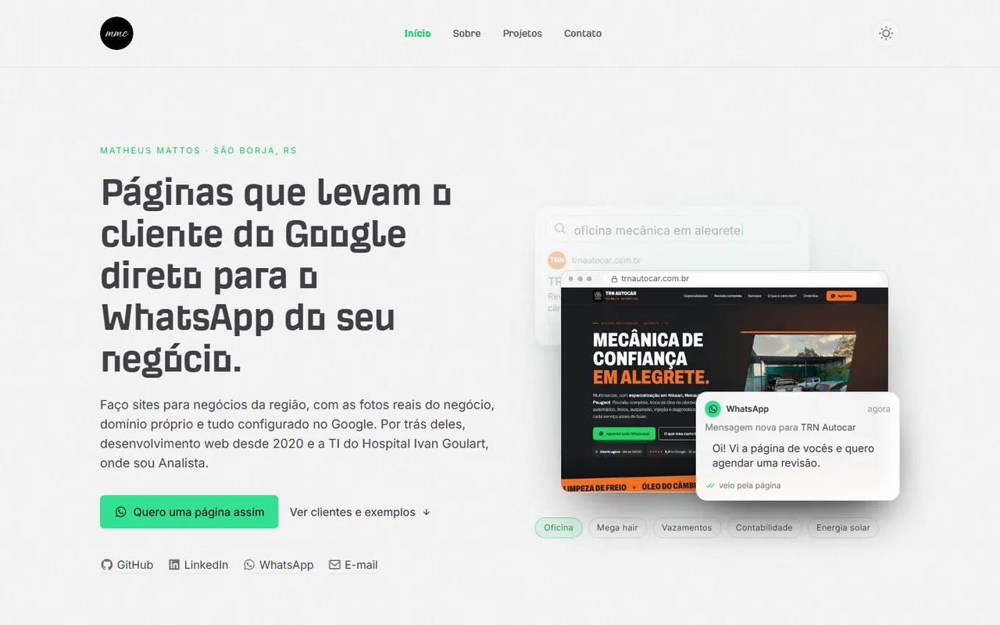

<div align="center">

# matheusmattos.dev

**Portfólio de Matheus Mattos Chaves: páginas para negócios locais que levam o cliente do Google direto para o WhatsApp, e os sistemas por trás delas.**

[](https://matheusdev-lovat.vercel.app)


</div>

<p align="center">
  
  
</p>

## Sobre

Site pessoal de um desenvolvedor full stack e Analista de TI de São Borja/RS. A página inicial vende um serviço concreto: sites para negócios da região, com as fotos reais do negócio, domínio próprio e tudo ligado ao Google e ao WhatsApp. As outras páginas mostram a trajetória, a stack e os sistemas que estão no ar.

O conteúdo principal mora no próprio repositório, em `app/data/`. O Sanity continua disponível como CMS opcional, com o Studio montado em `/studio`.

## Destaques

- **Abertura animada no topo** (`HeroStory`): uma busca no Google vira a página do negócio, e a página vira uma mensagem no WhatsApp. Botões por nicho trocam a cena. O HTML do servidor já sai com a primeira cena montada, a animação pausa fora da tela ou com a aba oculta e, com "reduzir movimento", não roda sozinha.
- **Cards de site com print duplo** (`SiteCard` + `PhoneFrame`): print do computador com um celular desenhado em CSS por cima. No mouse, o celular sobe e o print aproxima; no toque, o celular já aparece pela metade, então nada depende de hover.
- **Clientes e exemplos separados**: cada página entra com selo "Cliente" ou "Exemplo", a partir de listas tipadas em `app/data/local.ts`.
- **Depoimentos no formato de conversa** (`ChatQuote`): o balão mostra "digitando…" ao entrar na tela e depois a mensagem. Sem JS ou com movimento reduzido, a mensagem aparece direto.
- **Números que contam ao entrar na tela** (`Counter`), com o valor final já no HTML do servidor.
- **Faixa de nichos em rolagem contínua**, com `aria-label` listando os nichos e `motion-reduce:animate-none`.
- **Gráfico de contribuições do GitHub** (`react-github-calendar`) e linha do tempo de experiência e formação.
- **Tema claro e escuro** com `next-themes`.
- **Rede de segurança sem JavaScript**: um `<noscript>` no layout revela os blocos que o Framer Motion renderiza com `opacity: 0`.

## Páginas

| Rota | Conteúdo |
| --- | --- |
| `/` | Hero animado, nichos atendidos, números, clientes e exemplos, passo a passo do serviço, depoimentos, contribuições no GitHub e linha do tempo |
| `/about` | Bio, foto e a stack de trabalho (linguagens, ferramentas e hospedagem) |
| `/projects` | Grade de sites para negócios locais, sistemas e produtos com print, e repositórios públicos |
| `/contato` | Chamada para o WhatsApp e links sociais |
| `/studio` | Sanity Studio (só funciona com as variáveis do Sanity preenchidas) |
| `/api/revalidate` | Webhook do Sanity que revalida o cache por tag, com verificação de assinatura |

## Tecnologias

| Camada | Ferramentas |
| --- | --- |
| Framework | Next.js 14 (App Router), React 18, TypeScript |
| Estilo | Tailwind CSS 3, fontes locais (Incognito, GitLab Mono) e Inter via `next/font` |
| Animação | Framer Motion, com `useReducedMotion` |
| Ícones | react-icons |
| CMS (opcional) | Sanity 3 + next-sanity, com code input, tabela e Vision |
| Analytics (opcional) | Umami |
| Hospedagem | Vercel |

## SEO, desempenho e acessibilidade

- Identidade do site centralizada em [`lib/site.ts`](lib/site.ts): título, descrição, URL, idioma e imagem de Open Graph. Trocar o domínio é uma linha (`siteUrl`); canonical e Open Graph de todas as rotas derivam dali.
- Metadata por página (título, descrição, Open Graph e Twitter card) e `canonical` na raiz.
- `lang="pt-BR"` e `locale` `pt_BR`.
- Conteúdo acima da dobra sem animação de entrada, para aparecer no primeiro paint.
- Imagens com `next/image`, tamanhos responsivos (`sizes`) e logos pedidos em 2x para telas retina.
- O script do Umami só carrega quando existe um ID de site configurado.

## Estrutura

```text
app/
  page.tsx              # início
  about/ projects/ contato/
  studio/[[...index]]/  # Sanity Studio
  api/revalidate/       # webhook do Sanity
  components/
    local/              # HeroStory, SiteCard, PhoneFrame, ChatQuote, Counter, Steps, LocalWork
    pages/              # Job, Usage, gráfico do GitHub
    global/             # Navbar, MobileMenu, Footer, Theme
    shared/             # componentes herdados do template (blocos de texto rico, quiz, tabela)
  data/                 # conteúdo: local.ts, projects.ts, career.ts, profile.ts, stack.ts, social.ts
lib/
  site.ts               # identidade do site
  env.api.ts            # leitura das variáveis de ambiente
  sanity.*.ts           # cliente, queries e imagens do Sanity
schemas/                # schemas do Sanity
public/                 # imagens, logos e prints dos projetos
```

## Como rodar localmente

```bash
git clone https://github.com/MatheusMattos-Dev/portfolio.git
cd portfolio
npm install
cp .env.example .env.local   # opcional
npm run dev
```

O site sobe em `http://localhost:3000`. Scripts do `package.json`:

| Script | O que faz |
| --- | --- |
| `npm run dev` | servidor de desenvolvimento |
| `npm run build` | `next lint` e `next build` |
| `npm run start` | serve o build de produção |

### Variáveis de ambiente

Todas são opcionais. Sem elas o site sobe normalmente e o recurso correspondente fica desligado.

| Variável | Para que serve |
| --- | --- |
| `NEXT_PUBLIC_SANITY_PROJECT_ID` | liga o Sanity (sem ela, o CMS fica desligado e as consultas devolvem vazio) |
| `NEXT_PUBLIC_SANITY_DATASET` | dataset do Sanity (padrão `production`) |
| `NEXT_PUBLIC_SANITY_API_VERSION` | versão da API (padrão `2023-07-21`) |
| `NEXT_PUBLIC_SANITY_ACCESS_TOKEN` | token de leitura do Sanity |
| `NEXT_PUBLIC_SANITY_HOOK_SECRET` | assinatura do webhook de revalidação |
| `NEXT_PUBLIC_GITHUB_USERNAME` / `NEXT_PUBLIC_GITHUB_JOIN_YEAR` | sobrescrevem o usuário e o ano do gráfico de contribuições (o padrão fica em `lib/site.ts`) |
| `NEXT_PUBLIC_UMAMI_WEBSITE_ID` | analytics; vazio = o script não carrega |
| `NEXT_PUBLIC_GISCUS_REPO`, `NEXT_PUBLIC_GISCUS_REPOID`, `NEXT_PUBLIC_GISCUS_CATEGORYID` | comentários com Giscus, herança do template: são lidas em `lib/env.api.ts`, mas nenhuma página usa hoje |

## Conteúdo

Para editar textos, clientes, exemplos, projetos, carreira ou stack, altere os arquivos em `app/data/`. Os prints dos cards ficam em `public/projects/`. Quem quiser usar o Sanity cadastra o projeto em [sanity.io/manage](https://sanity.io/manage), preenche as variáveis e acessa o Studio em `/studio`.

## Deploy

Hospedado na Vercel, ligado a este repositório: cada push na `main` publica uma nova versão.

## Créditos

Este site parte do portfólio open source de [Victor Eke](https://victoreke.com) ([repositório original](https://github.com/Evavic44/victoreke.com)), publicado sob licença MIT. Textos, conteúdo e identidade visual são de Matheus Mattos Chaves. O aviso de copyright do autor original é mantido em [`LICENSE`](LICENSE) e os dados do template ficam registrados em `lib/site.ts`.

## Licença

MIT. Veja [`LICENSE`](LICENSE).

---

<sub>Feito por [Matheus Mattos Chaves](https://matheusdev-lovat.vercel.app) · [GitHub](https://github.com/MatheusMattos-Dev)</sub>
